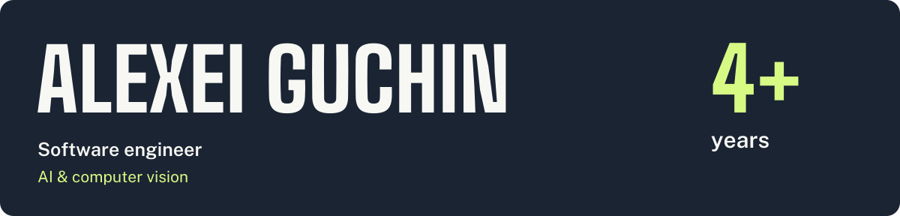

[Portfolio](https://alexeiguchin.me) · [LinkedIn](https://www.linkedin.com/in/alexei-guchin-corominas-6354341a6/)

Software engineer from Uruguay, based in the UK. Currently pursuing an **MSc in Computer Vision, Robotics & Machine Learning** at the **University of Surrey**.

## Work experience

| Company | Focus | Period |
| :--- | :--- | :--- |
| **UTE** · Uruguay | Android applications, backend systems, and Azure CI/CD · Java/Kotlin, C#, .NET, SQL Server | **Jul 2024 – Present** |
| **UXDivers** | GrialKit, international client products, and cross-platform mobile development · Xamarin.Forms → .NET MAUI | **Apr 2022 – Jun 2024** |

## Education

| Qualification | University | Period |
| :--- | :--- | :--- |
| **MSc Computer Vision, Robotics & Machine Learning** | University of Surrey · UK | **2026 – Present** |
| **Computer Engineering / Software Engineering** | Universidad de la República · Uruguay | **2019 – 2024** |

Graduation thesis: [apple anomaly detection and tracking](https://gitlab.fing.edu.uy/thomas.sheppard/proyecto-de-grado-calidad-de-manzanas-y-navegacion/-/tree/main/pipeline?ref_type=heads) from a camera-equipped orchard robot. **Grade: 12/12.**

## Selected projects

| Project | What it does | Built with |
| :--- | :--- | :--- |
| **[StreetSense](https://github.com/Alexeiguch/streetsense)** | Turns street-scene perception into spoken alerts for blind and low-vision pedestrians. Hackathon prototype. | Python · YOLO11 · OpenVINO · SegFormer |
| **[WhyBot](https://github.com/Alexeiguch/whybot)** | Investigates changes in metrics with multiple agents and cited SQL evidence. Hackathon submission. | Python · NVIDIA Nemotron · Zetaris |
| **[Timely](https://github.com/Alexeiguch/timely)** | An offline-first planner for web, iOS, and Android. In active development. | Next.js · Expo · TypeScript · PostgreSQL |
| **[FindMatch](https://findmatchuy.com)** | Connects players, matches, and venues through profiles, bookings, and payment flows. Personal project. | Next.js · React Native · Supabase |
| **[MacAnalytics](https://github.com/Alexeiguch/MacAnalytics)** | Reports CPU, memory, storage, battery, thermals, and network health on macOS. | C · macOS |
| **[TouchGame](https://github.com/Alexeiguch/TouchGame)** | Selects a winner from fingertips placed on a phone screen. | C# · .NET MAUI · iOS / Android |

## Tools

**AI & vision** · Python, PyTorch, YOLO, OpenVINO, computer vision, robotics  
**Product** · TypeScript, React, Next.js, Expo, React Native, Supabase  
**Systems & backend** · C#, .NET, C, PostgreSQL, SQL Server, APIs, CI/CD
